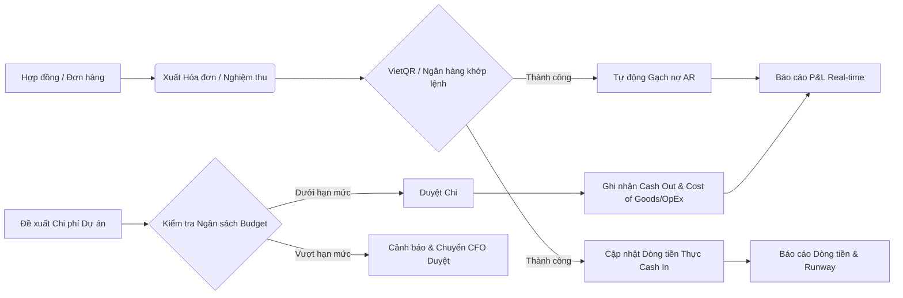
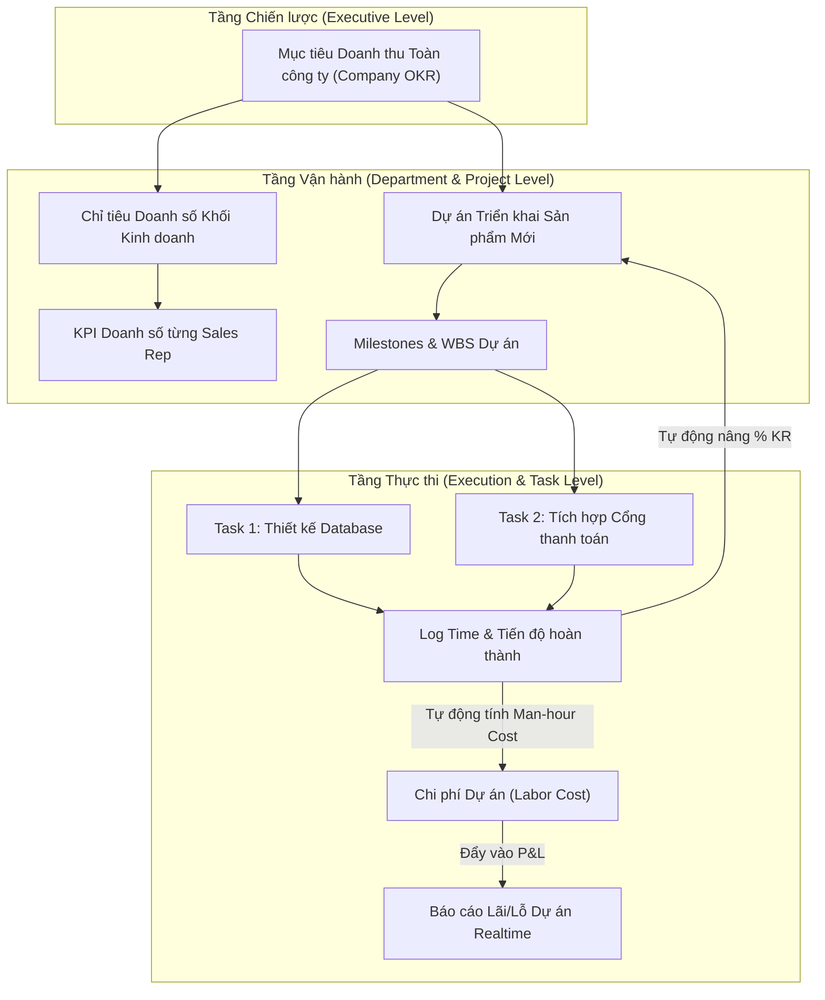
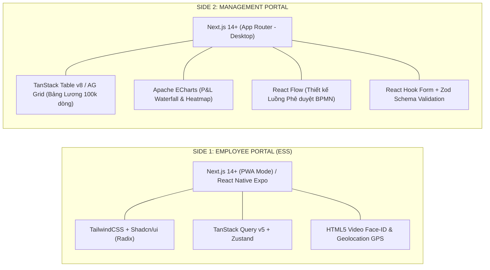
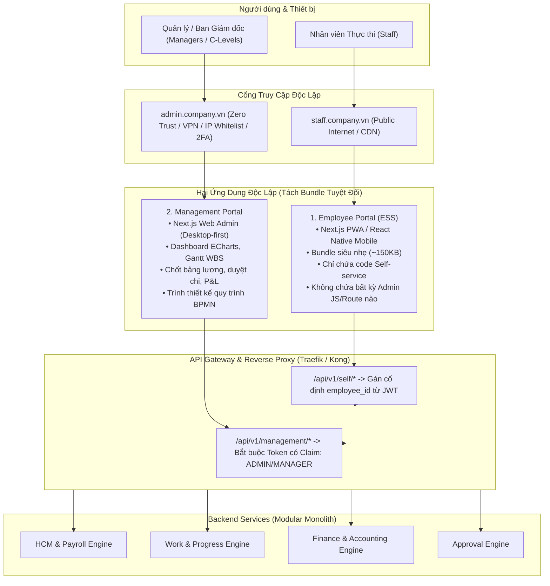
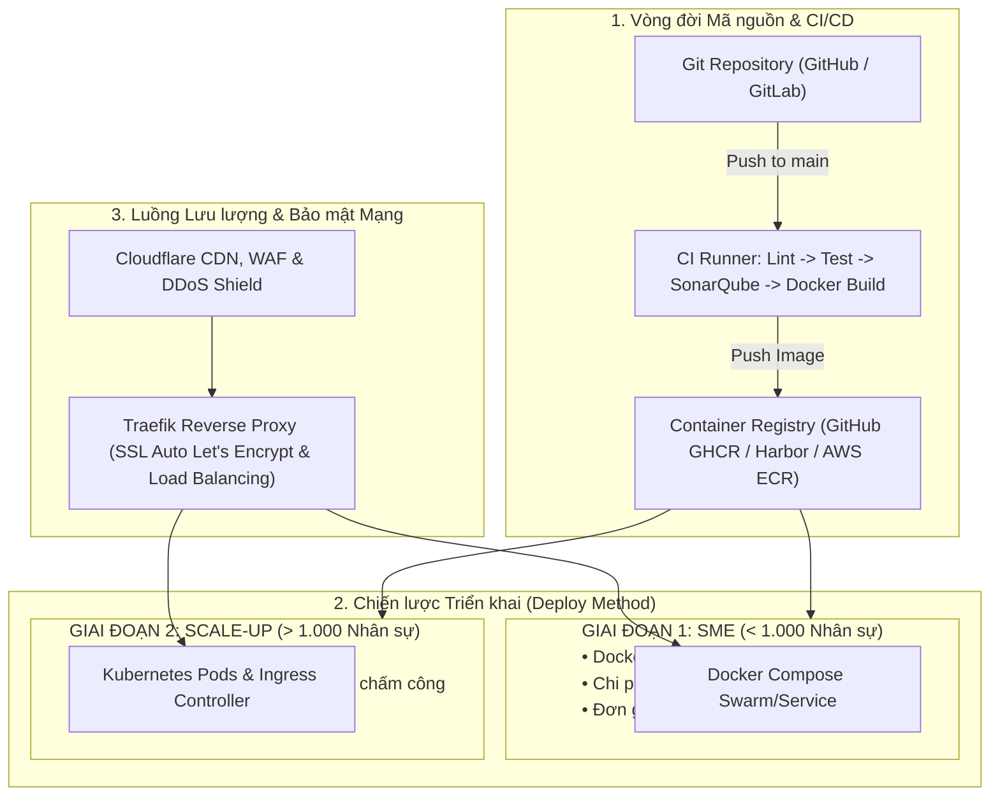
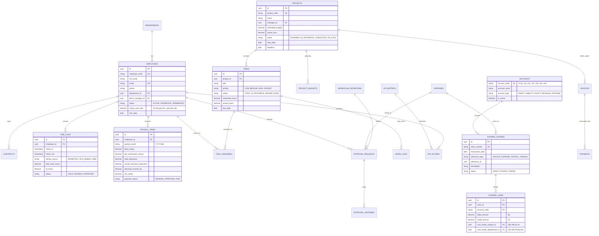
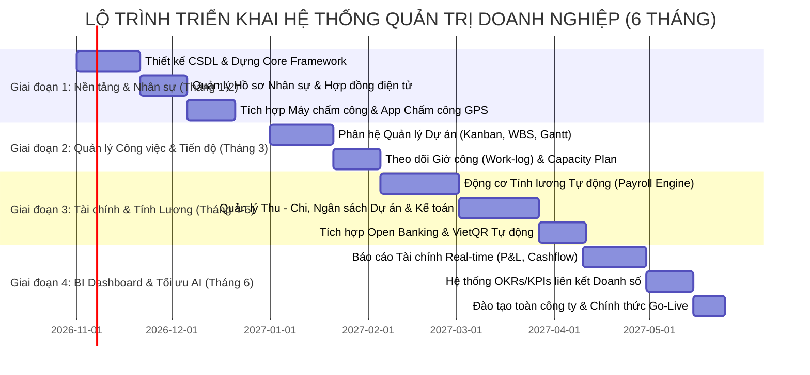

# TÀI LIỆU THIẾT KẾ HỆ THỐNG QUẢN TRỊ DOANH NGHIỆP TOÀN DIỆN (ENTERPRISE ERP & OPERATIONS SYSTEM)
**Dành cho: Báo cáo Tài chính - Quản trị Nhân sự (HCM) - Quản lý Tiến độ & Hiệu suất Công việc**

---

> **Tác giả:** Giám đốc Kinh doanh & Kỹ sư trưởng Chuyển đổi số (Enterprise Architect & Commercial Director)  
> **Phiên bản:** 1.0.0 (Production Architecture Ready)  
> **Trạng thái:** Architecture Approved  
> **Mục tiêu:** Xây dựng hệ sinh thái số hóa vận hành "Data-Centric", loại bỏ silo thông tin giữa Tài chính – Kinh doanh – Nhân sự, tự động hóa quy trình phê duyệt và đo lường ROI trên từng đầu mối công việc.

---

## MỤC LỤC
1. [Góc nhìn Chiến lược: Nỗi đau Vận hành & Lời giải Chuyển đổi số](#1-g%C3%B3c-nh%C3%ACn-chi%E1%BA%BFn-l%C6%B0%E1%BB%A3c-n%E1%BB%97i-%C4%91au-v%E1%BA%ADn-h%C3%A0nh--l%E1%BB%9Di-gi%E1%BA%A3i-chuy%E1%BB%83n-%C4%91%E1%BB%95i-s%E1%BB%91)
2. [Mục tiêu Hệ thống & Nguyên tắc Kiến trúc](#2-m%E1%BB%A5c-ti%C3%AAu-h%E1%BB%87-th%E1%BB%91ng--nguy%C3%AAn-t%E1%BA%AFc-ki%E1%BA%BFn-tr%C3%BAc)
3. [Thiết kế Chi tiết Các Phân hệ Nghiệp vụ Cốt lõi](#3-thi%E1%BA%BFt-k%E1%BA%BF-chi-ti%E1%BA%BFt-c%C3%A1c-ph%C3%A2n-h%E1%BB%87-nghi%E1%BB%87p-v%E1%BB%A5-c%E1%BB%91t-l%C3%B5i)
   - 3.1. Phân hệ Quản trị Tài chính & Kế toán Quản trị (Financial Intelligence & Cashflow)
   - 3.2. Phân hệ Quản trị Nguồn nhân lực Toàn diện (HCM & Payroll Engine)
   - 3.3. Phân hệ Quản lý Tiến độ & Hiệu suất Công việc (Project Execution & OKR/KPI Engine)
   - 3.4. Động cơ Phê duyệt Đa cấp & Luồng Quy trình Động (Dynamic Approval & Workflow Engine)
4. [Kiến trúc Kỹ thuật Hệ thống (System Architecture)](#4-ki%E1%BA%BFn-tr%C3%BAc-k%E1%BB%B9-thu%E1%BA%ADt-h%E1%BB%87-th%E1%BB%91ng-system-architecture)
   - 4.1. Kiến trúc Tổng thể (Domain-Driven Modular Monolith)
   - 4.2. Đặc tả Ngăn xếp Công nghệ Cốt lõi: Backend & Frontend Deep Dive
   - 4.3. Kiến trúc Đóng gói & Phân tách Hai Phân hệ: Employee Portal (ESS) vs Management Portal
   - 4.4. Chiến lược Triển khai & Vận hành Hạ tầng (Deployment & DevOps Architecture)
5. [Thiết kế Cơ sở Dữ liệu Toàn diện (Database Design & ERD)](#5-thi%E1%BA%BFt-k%E1%BA%BF-c%C6%A1-s%E1%BB%9F-d%E1%BB%AF-li%E1%BB%87u-to%C3%A0n-di%E1%BB%87n-database-design--erd)
   - 5.1. Sơ đồ Quan hệ Thực thể (Mermaid ERD)
   - 5.2. Đặc tả Chi tiết các Bảng Dữ liệu Trọng yếu
6. [Tích hợp Tự động hóa & Chuyển đổi số Thực chiến (DX Integrations)](#6-t%C3%ADch-h%E1%BB%A3p-t%E1%BB%B1-%C4%91%E1%BB%99ng-h%C3%B3a--chuy%E1%BB%83n-%C4%91%E1%BB%95i-s%E1%BB%91-th%E1%BB%B1c-chi%E1%BA%BFn-dx-integrations)
7. [Bảo mật, Kiểm toán & Phân quyền Ma trận (Security & Audit Trail)](#7-b%E1%BA%A3o-m%E1%BA%ADt-ki%E1%BB%83m-to%C3%A1n--ph%C3%A2n-quy%E1%BB%81n-ma-tr%E1%BA%ADn-security--audit-trail)
   - 7.1. Ma trận Phân quyền Đa tầng (RBAC & ABAC Matrix)
   - 7.2. Cơ chế Sổ ký Kiểm toán Bất biến (Immutable Audit Trail)
   - 7.3. Cơ chế Bảo mật Zero-Trust giữa 2 Side (API Gateway Route Boundary & IDOR Prevention)
8. [Lộ trình Triển khai Phân kỳ (Rollout Roadmap & ROI Metrics)](#8-l%E1%BB%99-tr%C3%ACnh-tri%E1%BB%83n-khai-ph%C3%A2n-k%E1%BB%B3-rollout-roadmap--roi-metrics)

---

## 1. GÓC NHÌN CHIẾN LƯỢC: NỖI ĐAU VẬN HÀNH & LỜI GIẢI CHUYỂN ĐỔI SỐ

Dưới góc nhìn của một Giám đốc Kinh doanh lâu năm đã từng vận hành nhiều tổ chức quy mô từ hàng chục đến hàng nghìn nhân sự, các doanh nghiệp thường gặp 4 **"điểm nghẽn chết người"**:

```
+----------------------------------------------------------------------------------------------------+
|                                CÁC ĐIỂM NGHẼN KINH DOANH KINH ĐIỂN                                 |
+------------------------------------+---------------------------------------------------------------+
| Nỗi đau Tài chính:                | Số liệu chốt sổ trễ 15-30 ngày sau tháng. CEO/CCO ra quyết    |
|                                    | định bằng "linh cảm", không biết tiền mặt còn lại (Runway)    |
|                                    | thực sự duy trì được bao lâu, công nợ AR bị ứ đọng kéo dài.  |
+------------------------------------+---------------------------------------------------------------+
| Nỗi đau Nhân sự:                   | Tuyển nhiều nhưng năng suất không tăng. Chấm công thủ công,  |
|                                    | tính lương mất cả tuần, tranh cãi về hoa hồng và KPI.         |
+------------------------------------+---------------------------------------------------------------+
| Nỗi đau Tiến độ & Năng suất:       | Họp hành liên miên nhưng dự án trễ hạn (Overdue Task).         |
|                                    | Nhân sự giỏi bị quá tải (burnout), nhân sự yếu ngồi nhàn rỗi. |
|                                    | Không gắn kết được kết quả công việc với chi phí nhân sự.     |
+------------------------------------+---------------------------------------------------------------+
| Nỗi đau Tách rời Dữ liệu (Silos):  | Kinh doanh dùng 1 bảng tính, Kế toán dùng 1 phần mềm riêng,  |
|                                    | Nhân sự lưu trữ file Word/Excel. Không có "Single Source of   |
|                                    | Truth" (Nguồn chân lý duy nhất).                             |
+------------------------------------+---------------------------------------------------------------+
```

### Lời giải Chuyển đổi số (The DX Solution Blueprint)
Hệ thống này được thiết kế không phải để tạo ra thêm thủ tục hành chính, mà là **động cơ tự động hóa**:
1. **Gắn liền Tiến độ công việc với Dòng tiền:** Mỗi dự án, mỗi đầu việc đều có `Budget Cost` và `Labor Cost`. Người quản lý nhìn thấy ngay biên lợi nhuận thời gian thực.
2. **Kế toán kép (Double-entry) quản trị số liệu thời gian thực:** Doanh thu ghi nhận ngay khi có xác nhận nghiệm thu; dòng tiền phản ánh ngay khi API Ngân hàng khớp lệnh.
3. **Cơ chế Thưởng – Đánh giá minh bạch:** KPI tính tự động dựa trên tiến độ hoàn thành task và kết quả doanh số thực tế, triệt tiêu cảm tính.

---

## 2. MỤC TIÊU HỆ THỐNG & NGUYÊN TẮC KIẾN TRÚC

### 2.1. Mục tiêu Cốt lõi (System Core OKRs)
* **Thời gian chốt báo cáo:** Giảm từ **15 ngày** xuống **Real-time / T+1**.
* **Chu kỳ tính lương & thưởng:** Tự động tính toán trong vòng **< 15 phút** cho 1.000 nhân viên.
* **Tỷ lệ dự án đúng tiến độ:** Tăng tối thiểu **35%** nhờ cảnh báo tự động Bottleneck và phân bổ tải (Workload balancing).
* **Kiểm soát rủi ro thất thoát:** 100% giao dịch thu chi vượt hạn mức ngân sách đều bị chặn hoặc yêu cầu duyệt cấp C-level tự động.

### 2.2. Bốn Nguyên tắc Vàng Thiết kế Kiến trúc (Architectural Principles)
1. **Domain-Driven Design (DDD) & Loosely Coupled Modules:** Các phân hệ (Finance, HR, Task) đóng gói logic độc lập nhưng kết nối qua Event Bus & Domain Services. Có thể mở rộng từ Modular Monolith lên Microservices mà không đập đi viết lại.
2. **Immutable Audit Trail (Sổ cái Bất biến):** Tuyệt đối không xóa mềm/xóa cứng (Hard DELETE) đối với các bảng giao dịch Tài chính, Lịch sử duyệt, và Chấm công. Mọi biến động đều được lưu vết `who, when, what, why, ip, previous_value`.
3. **Mobile-First & Real-time Connectivity:** Lãnh đạo duyệt chi, duyệt nghỉ phép, xem P&L qua Mobile App/Web PWA trong 3 click. Nhân sự nhận thông báo tức thời qua WebSocket và Zalo/Telegram.
4. **Security by Default:** Phân quyền theo ma trận Vai trò (RBAC) kết hợp Thuộc tính (ABAC - Attribute-Based Access Control) theo phòng ban, chi nhánh và hạn mức phê duyệt.

---

## 3. THIẾT KẾ CHI TIẾT CÁC PHÂN HỆ NGHIỆP VỤ CỐT LÕI

### 3.1. Phân hệ Quản trị Tài chính & Kế toán Quản trị (Financial Intelligence & Cashflow)

#### Chức năng nghiệp vụ:
* **Hệ thống Kế toán Quản trị Thời gian thực (Management Accounting):**
  - Quản trị Doanh thu (Accrual Accounting vs Cash Accounting).
  - Tách bạch rõ ràng Doanh thu Đã Thu (Cash in), Doanh thu Đã Giao hàng/Nghiệm thu (Earned Revenue) và Doanh thu Hoãn lại (Deferred Revenue).
* **Báo cáo Tài chính Động (Dynamic Financial Statements):**
  - **P&L (Profit and Loss / Báo cáo Kết quả Kinh doanh):** Drill-down trực tiếp từ Tổng doanh thu -> Hợp đồng -> Dự án -> Task/Chi phí liên quan.
  - **Cashflow (Báo cáo Dòng tiền Trực tiếp & Gián tiếp):** Theo dõi Runway (số tháng doanh nghiệp còn có thể sống sót dựa trên số dư tiền mặt hiện tại và tốc độ đốt tiền `Burn Rate`).
  - **Bảng Cân đối Kế toán Quản trị (Balance Sheet):** Quản trị Tài sản, Công nợ phải thu (AR - Accounts Receivable) và Công nợ phải trả (AP - Accounts Payable).
* **Quản trị Ngân sách & Cảnh báo Cháy Ngân sách (Budget Burn-rate Engine):**
  - Phân bổ ngân sách theo Phòng ban / Dự án / Quý.
  - Tự động cảnh báo khi chi phí chạm ngưỡng 80%, và khóa tạo đề xuất chi khi chạm 100% ngân sách nếu không có phê duyệt ngoại lệ của CFO/CEO.
* **Auto-Reconciliation (Khớp lệnh Ngân hàng Tự động):**
  - Kết nối Open Banking (VietinBank, Vietcombank, Techcombank, MB, VPBank) qua Webhook/VietQR PRO.
  - Tự động gạch nợ hóa đơn khi khách hàng thanh toán đúng mã tham chiếu.



---

### 3.2. Phân hệ Quản trị Nguồn nhân lực Toàn diện (HCM & Payroll Engine)

#### Chức năng nghiệp vụ:
* **Quản trị Vòng đời Nhân sự (Employee Lifecycle Management):**
  - Tuyển dụng (Applicant Tracking System - ATS) -> Onboarding số (Ký HĐ điện tử, cấp tài khoản, phát tài sản) -> Đánh giá định kỳ -> Offboarding (Bàn giao tài sản, thanh toán quyết toán).
  - Sơ đồ tổ chức động (Dynamic Org Chart), quản lý ma trận Báo cáo Trực tiếp (Direct Manager) và Báo cáo Dự án (Dotted-line Manager).
* **Chấm công Thông minh Đa kênh (Omni-channel Time Attendance):**
  - Tích hợp máy chấm công vân tay/khuôn mặt (ZKTeco, Hikvision) qua HTTP Push/Webhook.
  - Chấm công di động qua GPS Geofencing + Nhận diện khuôn mặt (AI Face Anti-spoofing).
  - Quản lý ca kíp linh hoạt, tự động tính toán đi muộn, về sớm, OT (Overtime) tuân thủ Luật Lao động Việt Nam.
* **Động cơ Tính lương Động (Configurable Payroll Calculation Engine):**
  - Hỗ trợ công thức tính lương cấu hình bằng JSON/Script logic (không cần sửa code hệ thống khi thay đổi chính sách thưởng).
  - Tự động trừ đóng BHXH, BHYT, BHTN và Thuế TNCN lũy tiến từng phần theo quy định mới nhất.
  - Tích hợp dữ liệu KPI/Doanh số từ Phân hệ Tiến độ/Kinh doanh để tính Commission/Thưởng hiệu suất tức thời.
  - Xuất Payslip điện tử bảo mật (PDF mã hóa mật khẩu gửi qua App/Email).

---

### 3.3. Phân hệ Quản lý Tiến độ & Hiệu suất Công việc (Project Execution & OKR/KPI Engine)

#### Chức năng nghiệp vụ:
* **Quản trị Công việc Đa góc nhìn (Multi-view Task & Project Management):**
  - Hỗ trợ Kanban Board, Gantt Chart (Phụ thuộc công việc - Dependencies & Critical Path), Bảng danh sách (List View), Lịch (Calendar View).
  - WBS (Work Breakdown Structure): Chia nhỏ Dự án -> Milestone -> Task -> Subtask.
* **Quản trị Tài nguyên & Tải Công việc (Workload Balancing & Capacity Planning):**
  - Biểu đồ nhiệt (Heatmap) thể hiện khối lượng công việc của từng cá nhân theo giờ/tuần.
  - Ngăn ngừa tình trạng nhân sự bị Over-allocated hoặc Under-allocated.
* **Liên kết Tiến độ với Chi phí Dự án (Earned Value Management - EVM):**
  - Mỗi giờ làm việc (Man-hour) nhân viên log vào task sẽ tự động nhân với Đơn giá giờ làm việc (Hourly Labor Rate) để tính ra `Actual Cost of Work Performed (ACWP)`.
  - Giám đốc kinh doanh biết chính xác dự án này đang LÃI hay LỖ theo thời gian thực mà không cần đợi kế toán tính lương.
* **Động cơ OKRs & KPIs Đồng bộ:**
  - Mục tiêu công ty (Company OKR) cascaded xuống Phòng ban (Department OKR) và Cá nhân (Individual OKR).
  - Key Result (KR) tự động cập nhật phần trăm hoàn thành dựa trên tiến độ các Task hoặc Doanh số thực tế ghi nhận trên hệ thống.



---

### 3.4. Động cơ Phê duyệt Đa cấp & Luồng Quy trình Động (Dynamic Approval & Workflow Engine)

* **Thiết kế theo chuẩn BPMN 2.0 thu gọn:**
  - Cho phép Admin kéo thả hoặc cấu hình luồng phê duyệt: `Đơn xin nghỉ phép`, `Đề xuất tạm ứng`, `Duyệt chi phí tiếp khách`, `Duyệt hợp đồng giảm giá`.
* **Điều kiện Rẽ nhánh Động (Conditional Routing):**
  - *Ví dụ:* Đề xuất chi phí < 10 triệu VNĐ -> Trưởng phòng duyệt (1 cấp).  
    Từ 10 - 100 triệu VNĐ -> Trưởng phòng + Kế toán trưởng duyệt (2 cấp).  
    Trên 100 triệu VNĐ -> Phải có Tổng Giám đốc duyệt (3 cấp).
* **Cơ chế SLA & Escalation:**
  - Nếu sau 24h cấp có thẩm quyền không phản hồi, tự động gửi cảnh báo khẩn cấp hoặc tự động leo thang (Escalate) lên cấp cao hơn.

---

## 4. KIẾN TRÚC KỸ THUẬT HỆ THỐNG (SYSTEM ARCHITECTURE)

### 4.1. Kiến trúc Tổng thể: Modular Monolith (Microservices-Ready)

Để tối ưu hóa chi phí vận hành, giảm độ trễ dữ liệu giao dịch phức tạp (đặc biệt là Kế toán kép cần ACID), hệ thống được thiết kế theo mô hình **Modular Monolith** kết hợp **Domain-Driven Design (DDD)** và **Clean Architecture (Hexagonal Architecture)**. 

Khi tổ chức đạt quy mô dữ liệu lớn, các module độc lập (Finance, HR, Task) có thể dễ dàng tách thành các Microservices độc lập nhờ việc giao tiếp qua Event Bus (In-memory hoặc Message Broker).

```mermaid
flowchart TB
    subgraph ClientLayer["Clients & Gateway Layer"]
        WebAdmin["Next.js Web Admin Portal"]
        MobileApp["React Native / Flutter Mobile App"]
        API_GW["API Gateway (Traefik / Kong / NGINX) - Rate Limiting, SSL, Auth Guard"]
    end

    subgraph AppCore["Core Application (Modular Monolith)"]
        subgraph AuthDomain["1. Identity & Access Control"]
            Keycloak["JWT / OAuth2 / RBAC / ABAC Engine"]
        en

        subgraph FinanceDomain["2. Finance & Accounting Module"]
            LedgerSvc["General Ledger Service"]
            InvoiceSvc["Invoice & AR/AP Service"]
            BudgetSvc["Budgeting & Cashflow Engine"]
        end

        subgraph HRDomain["3. Human Capital Management Module"]
            EmpSvc["Employee Core & OrgChart"]
            AttendanceSvc["Time Tracking & Biometric Syncer"]
            PayrollSvc["Dynamic Payroll Calculator"]
        end

        subgraph TaskDomain["4. Work & Performance Module"]
            ProjectSvc["Project & Task (WBS/Gantt) Engine"]
            CapacitySvc["Workload & Resource Balancer"]
            OkrKpiSvc["OKR / KPI Tracking Service"]
        end

        subgraph WorkflowDomain["5. Workflow & Approval Engine"]
            BpmEngine["State Machine & Approval Matrix"]
        end

        EventBus["Internal Event Bus / Message Broker (Redis Streams / RabbitMQ)"]
    end

    subgraph DataLayer["Data & Persistence Layer"]
        Postgres[(Primary OLTP: PostgreSQL with Row-Level Security)]
        RedisCache[(In-Memory Cache & Session: Redis)]
        Clickhouse[(OLAP Analytics / BI Reports: ClickHouse / TimescaleDB)]
        MinIO[(Object Storage: S3 / MinIO for Invoices, Contracts, Avatars)]
    end

    subgraph ExternalServices["External Integrations"]
        BankAPI["Open Banking / VietQR APIs"]
        BioDevice["ZKTeco / Hikvision Biometric Readers"]
        NotifService["Zalo ZNS / Telegram Bot / SendGrid Email"]
    end

    ClientLayer --> API_GW
    API_GW --> AuthDomain
    API_GW --> FinanceDomain
    API_GW --> HRDomain
    API_GW --> TaskDomain
    API_GW --> WorkflowDomain

    FinanceDomain -.->|Publish Event: InvoicePaid| EventBus
    HRDomain -.->|Publish Event: AttendanceFinalized| EventBus
    TaskDomain -.->|Publish Event: TaskCompleted| EventBus
    EventBus -.->|Consume| WorkflowDomain
    EventBus -.->|ETL Stream| Clickhouse

    FinanceDomain --> Postgres
    HRDomain --> Postgres
    TaskDomain --> Postgres
    WorkflowDomain --> Postgres

    FinanceDomain --> BankAPI
    HRDomain --> BioDevice
    WorkflowDomain --> NotifService
    AppCore --> RedisCache
    AppCore --> MinIO
```

---

### 4.2. Đặc tả Ngăn xếp Công nghệ Cốt lõi: Backend & Frontend Deep Dive

Dưới góc nhìn kết hợp giữa Giám đốc Kinh doanh (tối ưu hóa chi phí tuyển dụng, sẵn có nhân tài trên thị trường Việt Nam) và Kỹ sư trưởng Chuyển đổi số (Type-Safety từ đầu đến cuối, dễ bảo trì, hiệu năng cao), ngăn xếp công nghệ được lựa chọn và chuẩn hóa như sau:

#### 4.2.1. Ngăn xếp Công nghệ Phía Máy chủ (Backend Deep Dive)

```
+──────────────────────────────────────────────────────────────────────────────────────────+
|                                CORE BACKEND ARCHITECTURE                                 |
+───────────────────────────+───────────────────────────+──────────────────────────────────+
| Phân lớp (Layer)          | Công nghệ Chỉ định        | Vai trò & Lý do Lựa chọn         |
+───────────────────────────+───────────────────────────+──────────────────────────────────+
| Core API Engine           | NestJS 10+ (TypeScript)   | Cấu trúc module hóa theo chuẩn   |
|                           |                           | Domain-Driven Design (DDD),      |
|                           |                           | Dependency Injection chặt chẽ,   |
|                           |                           | dễ tuyển dụng dev tại Việt Nam.  |
+───────────────────────────+───────────────────────────+──────────────────────────────────+
| High-Throughput Worker    | Golang (Go 1.22+)         | Dịch vụ Edge Worker lắng nghe    |
|                           |                           | máy chấm công phần cứng (TCP/    |
|                           |                           | HTTP Push) và xử lý stream ngân  |
|                           |                           | hàng với mức ngốn RAM < 30MB.    |
+───────────────────────────+───────────────────────────+──────────────────────────────────+
| Database ORM & Query      | Prisma ORM + Kysely /     | Prisma: Quản lý Migration,       |
|                           | Raw SQL                   | Schema type-safety, CRUD chuẩn.  |
|                           |                           | Kysely/Raw SQL: Cho các truy vấn |
|                           |                           | Báo cáo Tài chính P&L đa chiều.  |
+───────────────────────────+───────────────────────────+──────────────────────────────────+
| Hàng đợi & Background Job | BullMQ + Redis Cluster    | Xử lý hàng loạt: Gửi 1.000 phiếu |
|                           |                           | lương mã hóa, tính toán KPI nửa  |
|                           |                           | đêm, Webhook biến động số dư.    |
+───────────────────────────+───────────────────────────+──────────────────────────────────+
| Xác thực & Kiểm soát      | Passport.js (JWT) +       | Mật mã hóa mật khẩu bằng Argon2, |
|                           | Argon2id + CASL           | phân quyền thuộc tính ABAC       |
|                           |                           | (Attribute-Based Access Control).|
+───────────────────────────+───────────────────────────+──────────────────────────────────+
| Tài liệu Hóa API          | Swagger / OpenAPI v3      | Tự động sinh TypeScript SDK      |
|                           |                           | cho 2 ứng dụng Frontend.         |
+───────────────────────────+───────────────────────────+──────────────────────────────────+
```

#### 4.2.2. Ngăn xếp Công nghệ Giao diện Phân tách (Frontend Deep Dive: Side 1 vs Side 2)

Hệ thống phân tách rõ rệt công nghệ phù hợp với bản chất sử dụng của từng nhóm đối tượng:



* **Side 1 — Trang Nhân Viên (Employee Portal - Mobile First & PWA):**
  - **Framework:** Next.js 14+ đóng gói dưới dạng **PWA (Progressive Web App)** với Service Worker (cài đặt trực tiếp lên màn hình chính điện thoại iOS/Android mà không cần lên App Store, tiết kiệm 99$ Apple Developer và thời gian kiểm duyệt). Tùy chọn đóng gói sang **React Native (Expo)** khi doanh nghiệp yêu cầu bắt buộc app native.
  - **Quản lý Dữ liệu & Trạng thái:** **TanStack Query (React Query v5)** hỗ trợ cơ chế Stale-While-Revalidate, tự động cache offline khi nhân viên đi ra vùng sóng 4G yếu; kết hợp **Zustand** quản lý trạng thái phiên đăng nhập.
  - **Phần cứng Thiết bị:** Tích hợp trực tiếp Geolocation API (HTML5) và Camera Stream để nhân viên chụp ảnh khuôn mặt "Liveness Check" tại vị trí văn phòng/công trường.

* **Side 2 — Trang Quản lý & Admin (Management Portal - Desktop First):**
  - **Framework:** Next.js 14+ (App Router) với Server Components (RSC) giúp tải trước dữ liệu báo cáo tài chính từ server, tăng tốc độ hiển thị và bảo mật kết nối.
  - **Xử lý Bảng Dữ liệu Siêu Lớn:** Sử dụng **TanStack Table v8** kết hợp kỹ thuật Virtualization (hoặc **AG Grid**) cho phép cuộn mượt mà hàng trăm nghìn dòng dữ liệu Sổ cái Kế toán hoặc Bảng chấm công toàn công ty mà không đơ trình duyệt.
  - **Đồ thị Phân tích Quản trị:** **Apache ECharts** cung cấp biểu đồ dạng thác nước (Waterfall P&L), biểu đồ nhiệt (Heatmap phân bổ công việc), và Gantt chart trực quan cho Giám đốc theo dõi tiến độ WBS dự án.
  - **Công cụ Kéo-Thả Quy trình:** **React Flow** cho phép Admin tự vẽ luồng duyệt (ví dụ: Nhân viên $\rightarrow$ Trưởng nhóm $\rightarrow$ Giám đốc Tài chính) trực quan như sơ đồ tư duy.

---

### 4.3. Kiến trúc Đóng gói & Phân tách Hai Phân hệ: Employee Portal (ESS) vs Management Portal

Dưới lăng kính của Giám đốc Kinh doanh và Kỹ sư phần mềm, việc "gộp chung tất cả vào một ứng dụng rồi ẩn/hiện nút bấm bằng quyền" là **sai lầm nghiêm trọng cả về mặt vận hành lẫn bảo mật**:
* **Về mặt Vận hành (Business Operations):** Nhân viên mở ứng dụng chỉ muốn thao tác thật nhanh (chấm công trong 3 giây, nộp cái đơn xin nghỉ, xem bảng lương, xem việc hôm nay cần làm). Một giao diện nhồi nhét menu kế toán, cấu hình, quản trị sẽ gây quá tải nhận thức (Cognitive Overload), giảm tỷ lệ chấp nhận của nhân viên (Adoption Rate).
* **Về mặt Bảo mật (Application Security):** Nếu đóng gói chung 1 file JavaScript bundle cho cả Nhân viên và Quản lý, dù ẩn nút ở UI thì hacker hoặc nhân viên tò mò vẫn có thể mở **Chrome DevTools (F12) / inspect network** để dịch ngược source code, đọc được cấu trúc API quản trị, schema P&L hoặc cố tình gọi các endpoint nội bộ (IDOR Attack).

Do đó, hệ thống áp dụng chiến lược **"Phân tách Vật lý Tầng Giao diện (Physical Bundle Separation) & Phòng thủ Đa tầng Tầng Dịch vụ (Defense-in-Depth API)"**:



#### 4.3.1. Bảng So Sánh Ranh Giới Chức Năng Giữa 2 Phân Hệ

| Phân hệ Nghiệp vụ | 1. Trang Nhân Viên (Employee Portal - ESS) | 2. Trang Quản Lý / Admin (Management Portal) | Cơ chế Kiểm soát & Bảo vệ |
| :--- | :--- | :--- | :--- |
| **Giao diện & Trải nghiệm** | **Mobile-First / PWA**, giao diện tối giản, 1-click thao tác, tối ưu tải mạng 4G/5G khi đi đường. | **Desktop-First**, màn hình rộng, bảng dữ liệu lớn (DataGrid), biểu đồ phân tích đa chiều (ECharts/Gantt). | Tách thành 2 App độc lập trong Monorepo. |
| **Quản trị Tài chính** | **Tuyệt đối KHÔNG có quyền truy cập:** Không thấy doanh thu, không thấy chi phí, không thấy P&L công ty. | **Toàn quyền theo phân cấp:** Báo cáo P&L, dòng tiền, hạn mức ngân sách phòng ban, công nợ AR/AP, duyệt chi. | Route `/api/v1/finance/*` chặn 100% Token không có quyền Finance/Director. |
| **Chấm công & Ca kíp** | • Điểm danh GPS / Face ID.<br/>• Xem lịch ca làm việc cá nhân.<br/>• Tạo đơn giải trình khi quên chấm công. | • Giám sát bảng chấm công real-time toàn công ty.<br/>• Duyệt đơn giải trình đi muộn/về sớm.<br/>• Cấu hình phân ca, import máy vân tay. | Nhân viên chỉ xem/tạo bản ghi có `employee_id = req.user.id`. |
| **Lương & Đãi ngộ** | • Xem **Phiếu lương cá nhân (Payslip)**.<br/>• Yêu cầu nhập mã PIN/OTP thứ hai để mở xem.<br/>• Xem hoa hồng dự kiến của bản thân. | • Chạy bảng lương tự động hàng tháng (Payroll Run).<br/>• Điều chỉnh phụ cấp, chốt BHXH, Thuế TNCN.<br/>• Duyệt chi trả lương qua ngân hàng. | Tầng DB: Row-Level Security chặn truy vấn lương người khác. |
| **Quản lý Công việc & Tiến độ** | • Xem danh sách Task được giao (My To-Do).<br/>• Kéo thả Kanban cá nhân, cập nhật tiến độ %.<br/>• Log giờ làm việc (Work-log) vào task. | • Quản lý WBS Dự án, điều phối tài nguyên Gantt Chart.<br/>• Biểu đồ nhiệt quá tải nhân sự (Workload Heatmap).<br/>• Phê duyệt nghiệm thu Task/Milestone. | Nhân viên chỉ được Update trường `status`, `progress`, `work_log` của Task mình được Assign. |
| **Hệ thống Phê duyệt** | • Tạo đề xuất: Xin nghỉ phép, tạm ứng, thanh toán.<br/>• Theo dõi trạng thái duyệt theo thời gian thực. | • Hộp thư duyệt tập trung (Approval Inbox).<br/>• Duyệt nhanh 1-chạm hoặc từ chối kèm lý do.<br/>• Cấu hình ma trận thẩm quyền duyệt theo số tiền. | Trình xử lý Workflow kiểm tra quyền Manager trước khi cho phép Trigger State Transition. |

#### 4.3.2. Cấu trúc Đóng gói Dự án (Monorepo Workspace Structure)
Sử dụng mô hình Monorepo (quản lý bằng **Turborepo** hoặc **Nx**) giúp chia sẻ dùng chung các định nghĩa Type, Schema validation, UI Kit nhưng tách rời hoàn toàn 2 ứng dụng lúc build:

```bash
enterprise-core-workspace/
├── apps/
│   ├── employee-portal/          # [SIDE 1] Ứng dụng Nhân viên (Next.js PWA / React Native)
│   │   ├── src/app/
│   │   │   ├── (auth)/           # Đăng nhập nhân viên
│   │   │   ├── my-tasks/         # Task cá nhân & Log giờ
│   │   │   ├── my-attendance/    # Chấm công 1 chạm GPS / FaceID
│   │   │   ├── my-payslips/      # Phiếu lương bảo mật
│   │   │   └── my-requests/      # Đơn từ & Đề xuất cá nhân
│   │   └── package.json          # Bundle siêu nhẹ, KHÔNG chứa thư viện Gantt/Chart nặng
│   │
│   ├── management-portal/        # [SIDE 2] Cổng Quản trị & Điều hành (Next.js Web Admin)
│   │   ├── src/app/
│   │   │   ├── dashboard/        # Executive P&L, Runway, Doanh số Realtime
│   │   │   ├── hcm/              # Hồ sơ nhân sự, Hợp đồng, Chạy bảng lương
│   │   │   ├── operations/       # Gantt Chart, Phân bổ tải nhân sự, WBS
│   │   │   ├── finance/          # Sổ cái, Thu chi, Ngân sách, Khớp lệnh VietQR
│   │   │   ├── approvals/        # Trạm phê duyệt tập trung
│   │   │   └── settings/         # Phân quyền RBAC, Cấu hình luồng BPMN
│   │   └── package.json          # Chứa ECharts, WBS Gantt Engine, DataGrid
│   │
│   └── backend-api/              # Core API Services (NestJS / Go)
│
└── packages/                     # Thư viện dùng chung nội bộ
    ├── types/                    # Shared DTOs, Enums, TypeScript Interfaces
    ├── ui/                       # Tailwind UI Design System chuẩn thương hiệu
    └── validators/               # Zod Schemas kiểm tra dữ liệu đầu vào
```

#### 4.3.3. Lợi ích Cốt lõi của Chiến lược Đóng gói Tách rời
1. **Tuyệt đối không lộ mã nguồn Admin (Zero Client-side Leakage):** Không một dòng mã nào liên quan đến logic duyệt chi, bảng lương giám đốc hay endpoint tài chính tồn tại trong gói cài đặt của nhân viên.
2. **Tối ưu tốc độ tải trang (High Performance):** Trang nhân viên đạt chỉ số Core Web Vitals tối đa, mở app tức thì trên điện thoại ngoài đường.
3. **Bảo mật mạng đa tầng (Network Segmentation):** Cổng quản lý `admin.company.vn` có thể được cô lập chỉ cho phép truy cập qua mạng nội bộ hoặc VPN công ty, trong khi cổng nhân viên `staff.company.vn` vẫn mở công khai để nhân viên đi thị trường chấm công linh hoạt.

---

### 4.4. Chiến lược Triển khai & Vận hành Hạ tầng (Deployment & DevOps Architecture)

Là một Giám đốc Kinh doanh am hiểu sâu về P&L và TCO (Total Cost of Ownership), tôi **tuyệt đối phản đối việc "vung tiền" dựng các cụm Kubernetes phức tạp, tốn kém hàng ngàn USD/tháng ngay từ ngày đầu** khi quy mô người dùng chưa cần đến. Thay vào đó, hệ thống áp dụng **"Chiến lược Hạ tầng Tiến hóa Thực chiến" (Pragmatic Evolutionary Infrastructure)**:



#### 4.4.1. Lựa chọn Phương thức Triển khai theo Quy mô Doanh nghiệp

| Quy mô Doanh nghiệp | Kiến trúc Hạ tầng Đề xuất | Công cụ Điều phối (Orchestrator) | Chi phí Hạ tầng Ước tính | Khả năng Đáp ứng Vận hành |
| :--- | :--- | :--- | :--- | :--- |
| **Giai đoạn 1: SME / MVP**<br/>*(50 - 500 nhân sự)* | **1 Dedicated Server / VPS High-RAM**<br/>(32GB RAM, 8 vCPU, NVMe Storage)<br/>*Hetzner / Viettel IDC / VNPT / AWS* | **Docker Compose + Coolify / Portainer** + Traefik Reverse Proxy | **~ 1.200.000 - 3.000.000 VNĐ / tháng**<br/>*(\$50 - \$120/tháng)* | Cực kỳ tinh gọn, triển khai trong 1 ngày, không cần đội ngũ DevOps toàn thời gian, tự động backup dữ liệu hàng đêm. |
| **Giai đoạn 2: Doanh nghiệp Lớn**<br/>*(500 - 5.000+ nhân sự)* | **Multi-Node Cluster**<br/>Tách riêng Database Master/Replica và Application Cluster | **Kubernetes (K3s gọn nhẹ hoặc AWS EKS / GCP GKE)** | **~ 8.000.000 - 25.000.000 VNĐ / tháng**<br/>*(\$350 - \$1.000/tháng)* | Tự động tăng số lượng Pods (HPA) khi 1.000 nhân viên cùng chấm công lúc 8h00 sáng; dự phòng lỗi (Failover Multi-Zone). |

#### 4.4.2. Đóng gói Container Tiêu chuẩn (Production Docker Multi-Stage Build)
Để đảm bảo tốc độ triển khai nhanh và loại bỏ tối đa lỗ hổng bảo mật, toàn bộ các ứng dụng đều được build bằng kỹ thuật **Multi-stage Build** trên nền tảng **Node Alpine / Distroless** và chạy dưới quyền người dùng không đặc quyền (`USER node` - Non-root):

* **Frontend (Next.js Standalone):** Dung lượng image sau đóng gói chỉ **~80MB** (thay vì 1GB nếu copy toàn bộ `node_modules`).
* **Backend (NestJS Production):** Image chỉ **~120MB**, loại bỏ toàn bộ `devDependencies` và TypeScript compiler sau khi đã biên dịch ra JavaScript thuần (`/dist`).
* **Edge Worker (Golang):** Biên dịch nhị phân tĩnh (Static Binary), image dung lượng siêu nhỏ **~25MB**, tiêu tốn chỉ 20MB RAM khi chạy thực tế.

#### 4.4.3. Pipeline Tự động hóa CI/CD (GitHub Actions Workflow)
Quy trình từ lúc Lập trình viên đẩy code đến khi hệ thống tự động cập nhật diễn ra trong **dưới 5 phút**:

```yaml
name: Production CI/CD Pipeline
on:
  push:
    branches: [ main ]

jobs:
  quality-gate:
    runs-on: ubuntu-latest
    steps:
      - uses: actions/checkout@v4
      - name: Setup Node.js & pnpm
        uses: pnpm/action-setup@v2
      - run: pnpm install --frozen-lockfile
      - run: pnpm lint && pnpm typecheck
      - run: pnpm test:unit

  build-and-deploy:
    needs: quality-gate
    runs-on: ubuntu-latest
    steps:
      - name: Build & Push Docker Images
        run: |
          docker build -t ghcr.io/company/employee-portal:${{ github.sha }} -f apps/employee-portal/Dockerfile .
          docker build -t ghcr.io/company/management-portal:${{ github.sha }} -f apps/management-portal/Dockerfile .
          docker build -t ghcr.io/company/backend-api:${{ github.sha }} -f services/backend-api/Dockerfile .
          docker push ghcr.io/company/...
      
      - name: Zero-Downtime Rolling Deployment via SSH & Webhook
        uses: appleboy/ssh-action@master
        with:
          host: ${{ secrets.PROD_SERVER_IP }}
          username: deployer
          key: ${{ secrets.PROD_SSH_KEY }}
          script: |
            cd /opt/enterprise-system
            docker compose pull
            docker compose up -d --remove-orphans --no-build
```

#### 4.4.4. Triển khai Không Gián đoạn (Zero-Downtime Deployment & Health Checks)
Doanh nghiệp vận hành 24/7 không thể chấp nhận việc "bảo trì hệ thống để cập nhật phiên bản mới":
1. **Cơ chế Health Checks:** Backend cung cấp 2 endpoint:
   - `/health/live`: Đảm bảo tiến trình vẫn còn chạy (Liveness).
   - `/health/ready`: Đảm bảo ứng dụng đã kết nối thành công tới PostgreSQL và Redis (Readiness).
2. **Rolling Update với Traefik Proxy:** Traefik sẽ chỉ chuyển hướng traffic sang Container phiên bản mới sau khi kiểm tra `/health/ready` trả về HTTP 200 OK. Nếu container mới bị lỗi khởi động, toàn bộ traffic vẫn được giữ nguyên ở container cũ — **hoàn toàn không làm rớt phiên làm việc của người dùng**.
3. **Chiến lược Di chuyển CSDL An toàn (Zero-Downtime DB Migration):**
   - Chỉ áp dụng các thay đổi Schema tương thích ngược (**Backward-compatible**): Thêm cột mới nullable, không đổi tên cột trực tiếp, không xóa cột đang dùng.
   - Chạy lệnh `prisma migrate deploy` độc lập trước khi kích hoạt container mới.

#### 4.4.5. Chiến lược Sao lưu Dữ liệu & Phục hồi Thảm họa (Backup & Disaster Recovery - DR)
Đối với hệ thống Tài chính và Nhân sự, **mất dữ liệu đồng nghĩa với khủng hoảng doanh nghiệp**. Chiến lược sao lưu tuân thủ nghiêm ngặt chuẩn quản trị rủi ro:

```
[PostgreSQL Database] ──(Ghi nhận liên tục)──► [WAL-G / pgBackRest] ──► [Offsite Cloud S3 (Mã hóa AES-256)]
                                                                               │
                                                      ┌────────────────────────┴────────────────────────┐
                                                      ▼                                                 ▼
                                        [Daily Encrypted Snapshot]                       [Point-in-Time Recovery]
                                        (Lưu trữ 30 ngày gần nhất)                       (Phục hồi về từng giây cụ thể)
```

* **Chỉ số RPO (Recovery Point Objective) $\le$ 5 phút:** 
  - Kích hoạt cơ chế PostgreSQL Write-Ahead Logging (WAL) stream trực tiếp lên Cloud Storage (AWS S3 hoặc MinIO Off-site). Nếu máy chủ bị cháy phần cứng, dữ liệu tài chính chỉ mất tối đa 5 phút giao dịch gần nhất.
* **Chỉ số RTO (Recovery Time Objective) $\le$ 30 phút:**
  - Kịch bản phục hồi thảm họa được viết sẵn thành script tự động hóa (`restore-dr.sh`). Toàn bộ cơ sở dữ liệu và cấu hình hệ thống có thể được dựng lại trên một máy chủ hoàn toàn mới chỉ trong vòng nửa giờ.
* **Nguyên tắc Sao lưu 3-2-1:** 
  - 3 bản copy dữ liệu (1 Live DB, 1 Local Snapshot, 1 Off-site S3).
  - 2 loại phương tiện lưu trữ khác nhau.
  - 1 bản sao lưu nằm độc lập tại một trung tâm dữ liệu khác hoàn toàn (ví dụ: Máy chủ chính đặt tại Viettel IDC Hà Nội, bản sao lưu đặt tại AWS S3 Singapore).

---

## 5. THIẾT KẾ CƠ SỞ DỮ LIỆU TOÀN DIỆN (DATABASE DESIGN & ERD)

### 5.1. Sơ đồ Quan hệ Thực thể (Mermaid ERD)



---

### 5.2. Đặc tả Chi tiết các Bảng Dữ liệu Trọng yếu (Production Schema Snippets)

#### 1. Bảng Kế toán Kép: `journal_entries` & `journal_lines`
*Quy tắc Bất biến:* Tổng Nợ (Sum Debit) phải luôn bằng Tổng Có (Sum Credit) trong một Giao dịch (`entry_id`). Dùng Database Constraint hoặc Trigger để chặn ghi nhận nếu bị lệch dù chỉ 1 đồng.

```sql
CREATE TABLE journal_entries (
    id UUID PRIMARY KEY DEFAULT gen_random_uuid(),
    entry_number VARCHAR(50) UNIQUE NOT NULL,
    transaction_date DATE NOT NULL,
    reference_type VARCHAR(30) NOT NULL, -- 'INVOICE', 'EXPENSE', 'PAYROLL', 'BANK_STATEMENT'
    reference_id UUID NULL,
    description TEXT NOT NULL,
    status VARCHAR(20) DEFAULT 'POSTED' CHECK (status IN ('DRAFT', 'POSTED', 'VOIDED')),
    created_by UUID NOT NULL,
    created_at TIMESTAMP WITH TIME ZONE DEFAULT CURRENT_TIMESTAMP
);

CREATE TABLE journal_lines (
    id UUID PRIMARY KEY DEFAULT gen_random_uuid(),
    entry_id UUID NOT NULL REFERENCES journal_entries(id) ON DELETE RESTRICT,
    account_code VARCHAR(20) NOT NULL REFERENCES accounts(account_code),
    debit_amount NUMERIC(15, 2) DEFAULT 0 CHECK (debit_amount >= 0),
    credit_amount NUMERIC(15, 2) DEFAULT 0 CHECK (credit_amount >= 0),
    project_id UUID NULL REFERENCES projects(id),
    department_id UUID NULL REFERENCES departments(id),
    note VARCHAR(255)
);

-- Index tối ưu hóa truy vấn Báo cáo P&L theo Dự án & Phòng ban tức thì
CREATE INDEX idx_journal_lines_account_project ON journal_lines(account_code, project_id);
CREATE INDEX idx_journal_lines_entry ON journal_lines(entry_id);
```

#### 2. Bảng Chấm công & Tự động Tính giờ: `time_logs`
```sql
CREATE TABLE time_logs (
    id UUID PRIMARY KEY DEFAULT gen_random_uuid(),
    employee_id UUID NOT NULL REFERENCES employees(id),
    work_date DATE NOT NULL,
    check_in TIMESTAMP WITH TIME ZONE,
    check_out TIMESTAMP WITH TIME ZONE,
    working_hours NUMERIC(4, 2) DEFAULT 0,
    overtime_hours NUMERIC(4, 2) DEFAULT 0,
    check_in_ip VARCHAR(45),
    check_in_latitude DOUBLE PRECISION,
    check_in_longitude DOUBLE PRECISION,
    verification_method VARCHAR(30), -- 'FINGERPRINT', 'FACE_ID', 'GPS_APP'
    is_late BOOLEAN DEFAULT FALSE,
    is_early_leave BOOLEAN DEFAULT FALSE,
    audit_status VARCHAR(20) DEFAULT 'AUTO_CONFIRMED',
    UNIQUE (employee_id, work_date)
);
```

#### 3. Bảng Nhiệm vụ & Theo dõi Giá trị Lao động: `tasks` & `work_logs`
```sql
CREATE TABLE work_logs (
    id UUID PRIMARY KEY DEFAULT gen_random_uuid(),
    task_id UUID NOT NULL REFERENCES tasks(id),
    employee_id UUID NOT NULL REFERENCES employees(id),
    log_date DATE NOT NULL,
    hours_spent NUMERIC(4, 2) NOT NULL CHECK (hours_spent > 0),
    hourly_cost_at_the_time NUMERIC(12, 2) NOT NULL, -- Snapshots đơn giá giờ công lúc làm
    billable_hours NUMERIC(4, 2) DEFAULT 0,
    description TEXT,
    created_at TIMESTAMP WITH TIME ZONE DEFAULT CURRENT_TIMESTAMP
);
```

---

## 6. TÍCH HỢP TỰ ĐỘNG HÓA & CHUYỂN ĐỔI SỐ THỰC CHIẾN (DX INTEGRATIONS)

Là một chuyên gia Chuyển đổi số, tôi không chỉ xây dựng một phần mềm lưu trữ dữ liệu tĩnh (Data Silo), mà xây dựng một **"Cỗ máy vận hành kết nối" (Connected Operational Engine)**:

```
                                  +---------------------------------------+
                                  |         HỆ THỐNG ERP TRUNG TÂM        |
                                  +---------------------------------------+
                                   /         |                 |         \
                                  /          |                 |          \
                                 v           v                 v           v
           +-----------------------+ +---------------+ +-------------+ +--------------------+
           | Open Banking / VietQR | | Máy Chấm công | | AI OCR & LLM| | Đa Kênh Tương Tác  |
           +-----------------------+ +---------------+ +-------------+ +--------------------+
           | * VietQR dynamic code | | * ZKTeco/Hik  | | * Quét HĐ đỏ| | * Zalo ZNS         |
           | * Khớp số dư tự động  | |   Push Protocol| |   VAT (PDF) | | * Telegram Bot     |
           | * Báo biến động số dư | | * Face ID Sync| | * Trích xuất| | * Microsoft Teams  |
           |   (Webhook Realtime)  | | * GPS App PWA | |   chi phí tự| | * Mobile Push Notif|
           |                       | |               | |   động      | |   (Duyệt trong 5s) |
           +-----------------------+ +---------------+ +-------------+ +--------------------+
```

### 6.1. Tự động hóa Dòng tiền qua Open Banking & VietQR Dynamic
1. **Xuất hóa đơn thanh toán:** Mỗi hợp đồng hoặc đơn hàng tự động sinh mã VietQR động chứa mã chuyển khoản chuẩn hóa (ví dụ: `PAY INV10293`).
2. **Lắng nghe Webhook Ngân hàng (Cassie/SePay/Bank API trực tiếp):**
   - Khi khách hàng quét QR chuyển tiền, Webhook bắn về hệ thống trong vòng 2 giây.
   - Hệ thống tự động phân tích cú pháp `INV10293`, đổi trạng thái hóa đơn sang `PAID`.
   - Bắn thông báo về Telegram nhóm Kinh doanh: *"Khách hàng A đã thanh toán 50.000.000 VNĐ cho Hợp đồng B. Doanh số được ghi nhận cho Sales Rep Nguyễn Văn X."*
   - Tự động sinh `journal_entries` vào Sổ cái: Nợ 112 (Tiền gửi ngân hàng) / Có 131 (Phải thu khách hàng). Không cần kế toán nhập tay!

### 6.2. Kết nối Máy chấm công Phần cứng (Biometric Hardware Syncer)
* Cài đặt một dịch vụ **Edge Gateway Worker (Go hoặc Node.js Daemon)** tại văn phòng/nhà máy:
  - Lắng nghe sự kiện từ máy chấm công ZKTeco / Hikvision qua ADMS Push Protocol hoặc TCP Socket.
  - Mã hóa gói tin và bắn về API Cloud trung tâm.
  - Tự động tính toán số phút đi muộn dựa theo quy định từng ca kíp. Nếu có bất thường (quên chấm về), tự động gửi thông báo qua App nhắc nhân viên làm đơn giải trình trực tuyến.

### 6.3. Ứng dụng AI Hỗ trợ Giám đốc & Nhân sự (AI Operations Copilot)
* **OCR Hóa đơn Chi phí:** Nhân viên đi tiếp khách chụp hóa đơn đỏ VAT gửi lên hệ thống. AI Vision (Google Document AI / Tesseract) tự động đọc Mã số thuế, Tên nhà cung cấp, Tổng tiền, Tiền thuế VAT và tự điền vào Form Đề nghị Thanh toán.
* **Cảnh báo Thông minh cho Giám đốc (Executive AI Insights):**
  - *"Dự án ERP - Giai đoạn 2 đang bị chậm tiến độ 18% so với Baseline. Nhân sự Dev chính đang bị phân bổ tới 130% công suất trong khi Tester đang trống 40% giờ làm việc."*
  - *"Dòng tiền dự kiến trong 45 ngày tới: Cần chi trả 850 triệu (Lương + Thuế + Tiền thuê mặt bằng), trong khi dòng tiền thu về dự kiến chỉ đạt 620 triệu. Khuyến nghị đẩy nhanh đôn đốc 3 khoản công nợ quá hạn sau..."*

---

## 7. BẢO MẬT, KIỂM TOÁN & PHÂN QUYỀN MA TRẬN (SECURITY & AUDIT TRAIL)

### 7.1. Ma trận Phân quyền Đa tầng (RBAC & ABAC Matrix)

Dưới góc nhìn giám đốc kinh doanh và bảo mật hệ thống, **bí mật kinh doanh, thông tin lương, và dữ liệu khách hàng** là tài sản sống còn:

| Vai trò (Role) | Báo cáo P&L Doanh nghiệp | Lương Chi tiết Từng người | Xem & Giao Task Dự án | Duyệt Chi phí Vận hành |
| :--- | :---: | :---: | :---: | :---: |
| **Tổng Giám đốc (CEO)** | Toàn quyền (Full) | Toàn quyền (Full) | Toàn bộ dự án | Toàn quyền phê duyệt |
| **Giám đốc Tài chính (CFO)** | Toàn quyền (Full) | Toàn quyền (Full) | Xem chi phí dự án | Toàn quyền thẩm định chi |
| **Giám đốc Kinh doanh (CCO)**| Doanh thu & Chi phí Sales | Xem hoa hồng Team Sales | Dự án Khối Sales | Duyệt chi trong Budget Sales |
| **Trưởng phòng (HOD)** | Không xem P&L chung | Chỉ xem giờ công & KPI Team| Dự án phòng ban mình | Duyệt đề xuất < Hạn mức |
| **Nhân viên (Staff)** | Không được xem | Chỉ xem Payslip của chính mình | Chỉ xem Task được giao | Chỉ tạo đề xuất cho mình |

### 7.2. Cơ chế Sổ ký Kiểm toán Bất biến (Immutable Audit Trail)
* Mọi hành vi cập nhật nhạy cảm (Sửa giờ chấm công, Sửa trạng thái task, Hủy hóa đơn, Xuất file Excel báo cáo) đều tự động được ghi nhận vào bảng `system_audit_logs`.
* Cấu trúc log kiểm toán:
```json
{
  "timestamp": "2026-10-13T08:50:00Z",
  "actor_id": "usr_9981",
  "actor_name": "Nguyễn Văn A (Kế toán)",
  "ip_address": "14.232.112.55",
  "action": "UPDATE_TIME_LOG",
  "target_entity": "time_logs",
  "target_id": "log_1204",
  "before_state": { "check_in": "08:45:00", "is_late": true },
  "after_state": { "check_in": "08:00:00", "is_late": false },
  "reason": "Giải trình lý do gặp khách hàng ngoài văn phòng đã có phê duyệt số #REQ-882"
}
```

### 7.3. Cơ chế Bảo mật Zero-Trust giữa 2 Side (API Gateway Boundary & IDOR Prevention)

Để đảm bảo việc phân chia 2 side (Nhân viên và Quản lý) không thể bị vượt mặt bởi các kỹ thuật can thiệp mạng hoặc sửa đổi request, kiến trúc áp dụng 4 lớp phòng thủ sâu (Defense-in-Depth):

```
[Client Request] 
      │
      ▼
1. Gateway Audience Filter ──(aud != 'management-portal' ?)──► [REJECT 403]
      │
      ▼
2. Role & Permission Guard ─(Không đủ Role/Dept Scope ?)─────► [REJECT 403]
      │
      ▼
3. Zero-IDOR Enforcement ───(Tự động inject req.user.id)─────► [Chỉ đọc đúng data của mình]
      │
      ▼
4. Database Row-Level Sec ───(Postgres RLS Policy)───────────► [Chặn ở tầng vật lý DB]
```

1. **Cô lập Định tuyến Gateway (Route Segmentation):**
   * Toàn bộ API cho nhân viên dùng tiền tố: `/api/v1/self/*` hoặc `/api/v1/my/*`.
   * Toàn bộ API cho quản trị dùng tiền tố: `/api/v1/management/*` hoặc `/api/v1/admin/*`.
2. **Triệt tiêu Hoàn toàn Lỗ hổng IDOR (Insecure Direct Object Reference):**
   * *Nỗi đau thực tế:* Rất nhiều phần mềm non trẻ bị lỗi IDOR — ví dụ API xem phiếu lương là `/api/v1/payslips?employee_id=102`, nhân viên chỉ cần sửa thành `employee_id=101` là xem được lương của sếp hoặc đồng nghiệp.
   * *Giải pháp Kỹ thuật chuẩn:* Ở toàn bộ các endpoint `/api/v1/self/*`, hệ thống **tuyệt đối không nhận `employee_id` từ URL query hay Request Body**. Backend Guard sẽ trích xuất `employee_id` trực tiếp từ trường `sub` (Subject) trong JWT Token đã được xác thực chữ ký số bằng Public Key (Asymmetric RSA256). Kẻ xấu không có cách nào giả mạo ID của người khác.
3. **Cơ chế Token Audience & Scope Binding:**
   * Token nhân viên phát hành cho Mobile/PWA chỉ chứa: `aud: "employee-portal"`, `roles: ["STAFF"]`.
   * Token cấp cho Quản trị viên sau khi hoàn tất 2FA/FIDO2 chứa: `aud: "management-portal"`, `roles: ["MANAGER", "DIRECTOR", "ADMIN"]`, `scopes: ["finance:read", "payroll:write"]`.
   * Nếu nhân viên trích xuất Token từ App nhân viên để gọi sang API Quản trị `/api/v1/management/*`, API Gateway sẽ từ chối ngay lập tức tại cửa ngõ vì sai `aud` (Audience mismatch).
4. **Phòng vệ Tầng Cơ sở Dữ liệu (PostgreSQL Row-Level Security - RLS):**
   * Ngay cả trong kịch bản xấu nhất (lập trình viên viết thiếu điều kiện `WHERE` trong câu truy vấn SQL), chính sách PostgreSQL RLS được bật ở mức bảng sẽ tự động gắn context `current_setting('app.current_user_id')`, đảm bảo nhân viên chỉ quét được các dòng dữ liệu của chính mình.

---

## 8. LỘ TRÌNH TRIỂN KHAI PHÂN KỲ (ROLLOUT ROADMAP & ROI METRICS)

Để một dự án Chuyển đổi số thành công mà không gây sốc cho đội ngũ nhân sự, tôi áp dụng chiến lược **"Phân kỳ Đánh chắc - Thắng nhanh" (Phased Agile Rollout)**:



### Bảng Đo lường Hiệu quả Đầu tư (ROI & Success Metrics)

| Chỉ số Hiệu quả (KPIs) | Trước khi Chuyển đổi số | Sau khi Triển khai Hệ thống | Lợi ích Kinh doanh (Business Value) |
| :--- | :---: | :---: | :--- |
| **Thời gian lập bảng lương** | 5 - 7 ngày làm việc | **< 2 giờ** (kiểm tra ngoại lệ) | Giảm 90% công sức phòng HR, triệt tiêu sai sót khiếu nại lương. |
| **Thời gian phê duyệt đề xuất chi**| 2 - 4 ngày (ký giấy tờ) | **15 - 30 phút** (qua App) | Tăng tốc độ phản ứng với thị trường và khách hàng. |
| **Báo cáo Lãi/Lỗ (P&L)** | Ngày 15 - 20 tháng sau | **Tức thì (Real-time)** | Ban Giám đốc cắt giảm chi phí lãng phí ngay trong tháng, cứu dòng tiền. |
| **Tỷ lệ Task/Dự án hoàn thành đúng hạn**| 60% | **> 85%** | Tối ưu hóa năng suất lao động (Output per Headcount), giữ chân khách hàng. |
| **Độ chính xác dữ liệu công nợ** | Lệch pha giữa Kế toán & Sales | **100% Đồng bộ** | Thu hồi công nợ AR nhanh hơn trung bình 12 ngày (DSO giảm). |

---

## 9. KẾT LUẬN & BƯỚC ĐI TIẾP THEO

Tài liệu thiết kế kiến trúc này là kim chỉ nam phối hợp giữa **Chiến lược Kinh doanh của Ban Điều hành** và **Năng lực Triển khai của Đội ngũ Công nghệ**. 

Một hệ thống quản trị xuất sắc không phải là một hệ thống phức tạp nhất, mà là hệ thống:
1. **Dễ dùng nhất cho nhân viên thực thi:** Giúp họ tiết kiệm thời gian báo cáo, tập trung vào tạo ra kết quả.
2. **Minh bạch nhất cho quản lý:** Mọi quyết định đều dựa trên số liệu thực (Data-backed), loại bỏ cảm tính.
3. **Bền vững và mở rộng linh hoạt về mặt kỹ thuật:** Nền tảng sạch, chuẩn module hóa, sẵn sàng mở rộng quy mô khi doanh thu và nhân sự tăng trưởng gấp 10 lần.

